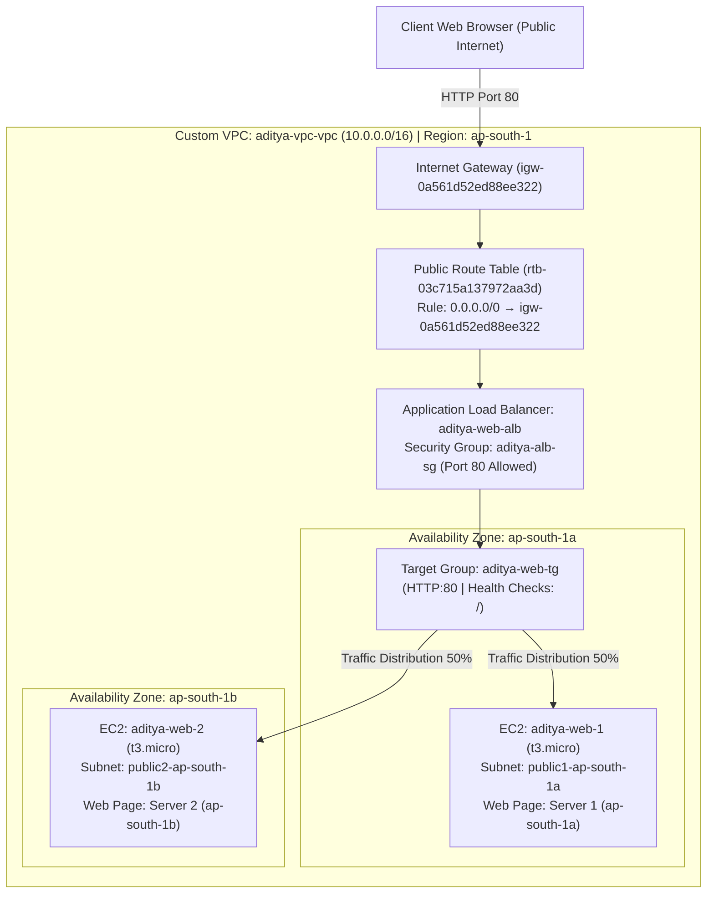

# Pimpri Chinchwad Education Trust's
# Pimpri Chinchwad College of Engineering
## Department of Computer Engineering
### Laboratory Practical / Assignment No. 4

---

**Course:** Cloud Computing (Laboratory)  
**Student Name:** Aditya Chandrajit Deore  
**PRN:** 124B1F116 &nbsp;&nbsp;|&nbsp;&nbsp; **Batch:** B3  
**Title:** Lab 4: Cloud Networking (VPC & Load Balancing)  
**Cloud Platforms:** Amazon Web Services (AWS) & Oracle Cloud Infrastructure (OCI Always Free Tier)  
**VPC / VCN Configuration:** `aditya-vpc-vpc` (`10.0.0.0/16`) in Region `ap-south-1` (Mumbai)  

---

## 1. Aim
To design, configure, and evaluate a custom Virtual Private Cloud (VPC) / Virtual Cloud Network (VCN) featuring public and private subnets, establish bidirectional and secure outbound internet connectivity using an Internet Gateway and route tables, launch two virtual machine compute instances distributed across multiple Availability Zones / Fault Domains, and implement an Application Load Balancer (ALB) with automated health checks to distribute incoming HTTP traffic and achieve high availability.

---

## 2. Objectives
1. To understand the architectural design principles of software-defined cloud networking, including VPC/VCN isolation, CIDR prefix allocation, and route table mechanics.
2. To differentiate between the routing policies, addressing schemes, and security postures of public vs. private subnets.
3. To configure virtual networking components: Internet Gateway (IGW), Network Address Translation (NAT) Gateway, and route tables adhering to the Longest Prefix Match (LPM) algorithm.
4. To implement multi-layered defense-in-depth security using stateful Security Groups / Network Security Groups (NSGs) and stateless Network ACLs / Security Lists.
5. To deploy two web server virtual machine instances (EC2 / OCI Compute) across distinct physical Availability Zones (`ap-south-1a` and `ap-south-1b`).
6. To provision an Application Load Balancer (ALB) with target group listeners and HTTP health checks.
7. To verify end-to-end traffic distribution, round-robin load balancing, and fault tolerance via real-time browser inspection.

---

## 3. High-Level Architecture & Traffic Flowchart



---

## 4. Theory & Technical Questions

### Q1. What is a Virtual Private Cloud (VPC)? Why is it important in cloud networking?
A **Virtual Private Cloud (VPC)** (termed **Virtual Cloud Network (VCN)** in Oracle Cloud Infrastructure) is a logically isolated, software-defined virtual network provisioned within a public cloud multi-tenant infrastructure. It provides dedicated virtual networking infrastructure tailored to an enterprise cloud account, behaving identically to an on-premises physical data center network while offering cloud scalability, elastic bandwidth, and automated provisioning.

#### Importance in Cloud Networking:
1. **Multi-Tenant Isolation:** Complete cryptographic and logical isolation between tenants sharing the same physical hyperscaler hardware.
2. **Granular Architectural Control:** Network engineers define custom private IP address ranges (IPv4/IPv6 CIDR blocks), subnet segmentations, route tables, network gateways, and stateful firewalls.
3. **Defense-in-Depth Security:** Allows separating public-facing ingress resources (load balancers, reverse proxies) from private operational tiers (application servers, relational databases).
4. **Hybrid Cloud Connectivity:** Seamlessly extends existing enterprise data centers into the cloud via IPSec Virtual Private Network (VPN) tunnels or dedicated private physical links (AWS Direct Connect / OCI FastConnect).
5. **Regulatory Compliance:** Essential for satisfying strict cybersecurity benchmarks (ISO 27001, SOC 2, PCI-DSS, HIPAA) requiring strict boundary segmentation of sensitive data workloads.

---

### Q2. Explain the difference between public subnet and private subnet.

| Comparison Dimension | Public Subnet | Private Subnet |
| :--- | :--- | :--- |
| **Routing Table Target** | Route table contains a default route (`0.0.0.0/0`) directing external traffic directly to an **Internet Gateway (IGW)**. | Route table contains **no route to an IGW**. External internet-bound traffic is routed to a **NAT Gateway** or restricted entirely. |
| **IP Addressing Scheme** | Instances receive a private IP (RFC 1918) and can be auto-assigned a globally routable **Public IPv4 address**. | Instances are assigned **strictly private IP addresses**. Public IP allocation is disabled by default. |
| **Inbound Internet Access** | **Permitted:** Direct inbound connections from the public internet (subject to security group rules). | **Prohibited:** Directly unreachable from the public internet; no public IP exists to address the host. |
| **Outbound Internet Access** | **Direct:** Packets exit directly through the Internet Gateway via 1:1 Network Address Translation. | **Indirect:** Outbound connections (software updates, OS patches) traverse a managed **NAT Gateway** in a public subnet. |
| **Typical Cloud Workloads** | Internet-facing Application Load Balancers (ALB), Public API Gateways, Bastion Jump Hosts, Reverse Proxies. | Core Application Business Logic, Microservice Clusters, Internal Databases (RDS, PostgreSQL, Oracle DB), Caching Tiers (Redis). |

---

### Q3. What are the main components of a VPC (e.g., route tables, internet gateway, security lists)?
A robust cloud network comprises seven foundational architectural primitives:
1. **CIDR Block (Classless Inter-Domain Routing):** The contiguous master private IP address space allocated to the VPC (e.g., `10.0.0.0/16`).
2. **Subnets:** Logical subdivisions of the VPC CIDR block bound to specific physical Availability Zones (AZs) or regional scopes, creating distinct broadcast domains.
3. **Route Tables:** Sets of routing rules (destination CIDR &rarr; target gateway) determining the network path traversed by outgoing packets.
4. **Internet Gateway (IGW):** A redundant, horizontally scaled software gateway facilitating bidirectional communication between public subnet instances and the public internet.
5. **NAT Gateway / NAT Instance:** A managed network translation service enabling private subnet instances to initiate outbound requests to the internet without allowing external internet clients to initiate inbound connections.
6. **Virtual Firewalls (Security Groups & NACLs / Security Lists):**
   - **Security Groups (AWS) / Network Security Groups (OCI):** Stateful, instance/VNIC-level packet filters.
   - **Network ACLs (AWS) / Security Lists (OCI):** Subnet-level packet filters.
7. **Load Balancers (ALB / NLB):** Intelligent reverse proxies distributing client traffic across healthy backend compute targets across multiple availability zones.

---

### Q4. What is the role of an Internet Gateway in a cloud network?
An **Internet Gateway (IGW)** is a horizontally scaled, redundant, highly available VPC component that enables communication between instances in your VPC and the internet. It introduces no availability risks or bandwidth constraints on network traffic.

#### Two Essential Roles:
1. **Default Routing Target:** It provides a destination target in the VPC route tables for internet-bound traffic via the default route `0.0.0.0/0`.
2. **1:1 Network Address Translation (NAT):** When an instance in a public subnet initiates an outbound connection, the IGW translates its private IPv4 address to its associated public IPv4 address. Conversely, for incoming traffic addressed to the instance's public IP, the IGW translates the destination public IP back into the instance's private IP before forwarding the packet into the VPC software-defined network overlay.

---

### Q5. How does network isolation improve security in a cloud environment?
Network isolation applies the **Principle of Least Privilege (PoLP)** and **Zero Trust Architecture** to network topologies:
1. **Attack Surface Reduction:** By placing database servers, payment engines, and backend APIs in private subnets with no public IPs, external attackers cannot directly scan, ping, or exploit them over the public internet.
2. **Blast Radius Containment:** If a public-facing web server or reverse proxy is compromised through a web application vulnerability, the attacker cannot freely pivot through the network; access to backend subnets is strictly policed by internal firewall rules.
3. **Defense-in-Depth:** Multiple complementary layers of protection (perimeter IGW &rarr; Subnet NACL / Security List &rarr; Instance Security Group &rarr; Host OS Firewall) ensure that the failure of any single security control does not expose core assets.
4. **Compliance Enforcement:** Regulatory standards (PCI-DSS Section 1.3, HIPAA Security Rule) mandate that cardholder data and protected health information (PHI) reside in network zones completely segregated from untrusted external networks.

---

### Q6. Define CIDR block and explain its purpose when creating a VPC.
**Classless Inter-Domain Routing (CIDR)** (defined in RFC 4632) is an IP addressing allocation standard that replaces traditional classful (Class A, B, C) network addressing. It expresses an IP network prefix using the notation:
$$\text{IPv4 Address} / \text{Prefix Length (bits)}$$

The number of available IP addresses is calculated as:
$$\text{Total Addresses} = 2^{(32 - \text{Prefix Length})}$$

For example, a `/16` CIDR block (`10.0.0.0/16`) provides:
$$2^{(32 - 16)} = 2^{16} = 65,536 \text{ addresses}$$
A `/20` subnet (`10.0.0.0/20`) provides:
$$2^{(32 - 20)} = 2^{12} = 4,096 \text{ addresses}$$
A `/24` subnet (`10.0.0.0/24`) provides:
$$2^{(32 - 24)} = 2^{8} = 256 \text{ addresses}$$

#### Cloud Provider Reserved Addresses:
- **AWS reserves 5 IP addresses** per subnet:
  - `x.x.x.0`: Network address.
  - `x.x.x.1`: Reserved by AWS for the VPC default router.
  - `x.x.x.2`: Reserved by AWS for the DNS resolver (AmazonProvidedDNS).
  - `x.x.x.3`: Reserved by AWS for future operational expansion.
  - `x.x.x.255`: Network broadcast address.
- **Oracle Cloud (OCI) reserves 3 IP addresses** per subnet (`.0` network, `.1` default gateway, `.2` reserved by OCI).

#### Purpose:
CIDR blocks allow network architects to right-size cloud infrastructure, allocate deterministic address space for dynamic autoscaling clusters, and ensure private IP spaces do not collide or overlap with existing on-premises or peered cloud corporate networks.

---

### Q7. What is the function of route tables in controlling traffic flow?
A **Route Table** acts as a virtual routing configuration table within a VPC/VCN that dictates how network traffic packets are steered from subnets to their intended destinations.

#### Mechanics of Route Tables:
1. **Longest Prefix Match (LPM) Evaluation:** When routing a packet, the virtual router evaluates all destination CIDR rules in the table and selects the most specific match (the one with the largest prefix length).
   - If traffic is sent to `10.0.0.15`, it matches `10.0.0.0/16` (`local`) rather than `0.0.0.0/0` (`igw`).
2. **Default Route (`0.0.0.0/0`):** Acts as the default gateway for any destination address that does not match a more specific local or peered route.
   - In a **Public Subnet**, `0.0.0.0/0 &rarr; Target: Internet Gateway`.
   - In a **Private Subnet**, `0.0.0.0/0 &rarr; Target: NAT Gateway`.
3. **Subnet Associations:** Each subnet must be explicitly or implicitly associated with a route table. Multiple subnets can share a single route table, but a subnet can only be associated with one route table at a time.

---

### Q8. Explain how security lists or network security groups (NSGs) are used to control inbound and outbound traffic.

Cloud platforms provide two layers of virtual firewalls:

#### 1. Security Groups (AWS) / Network Security Groups - NSGs (OCI):
- **Operating Scope:** Applied at the virtual network interface (ENI / VNIC) level of individual compute instances or load balancers.
- **Statefulness:** **Strictly Stateful.** If an inbound rule permits traffic on port 80, the return response traffic is automatically allowed outbound, regardless of outbound rules.
- **Rule Construction:** Allow-only rules (default deny). Supports specifying Source CIDR, individual IP addresses, or referencing other Security Groups (**Security Group Chaining**).

#### 2. Network ACLs (AWS) / Security Lists (OCI):
- **Operating Scope:** Applied at the subnet boundary.
- **Statefulness:**
  - In AWS, **Network ACLs are Stateless**. Both inbound and outbound ephemeral return ports (ports 1024–65535) must be explicitly allowed.
  - In OCI, **Security Lists can be stateful or stateless** depending on user configuration.
- **Rule Processing:** Processed sequentially in ascending numerical rule order; the first matching rule immediately dictates whether the packet is accepted or dropped.

---

### Q9. What are the steps to create a Virtual Cloud Network (VCN) in Oracle Cloud?
Oracle Cloud Infrastructure (OCI) offers an automated wizard to provision a production-ready VCN in the Always Free tier:

1. **Sign in to OCI Console:** Access `cloud.oracle.com` and select your home region (e.g., `ap-mumbai-1` or `ap-hyderabad-1`).
2. **Open Networking Navigation:** Expand the navigation burger menu &rarr; **Networking** &rarr; **Virtual Cloud Networks**.
3. **Launch VCN Wizard:** Click the **Start VCN Wizard** button. Select **Create VCN with Internet Connectivity** &rarr; click **Start VCN Wizard**.
4. **Define VCN Parameters:**
   - **VCN Name:** `aditya-pccoe-vcn`
   - **Compartment:** Select your root or designated laboratory compartment.
   - **VCN IPv4 CIDR Block:** `10.0.0.0/16`
   - **Public Subnet IPv4 CIDR Block:** `10.0.0.0/24`
   - **Private Subnet IPv4 CIDR Block:** `10.0.1.0/24`
5. **Review Automated Architecture:** The wizard automatically creates:
   - 1 Internet Gateway (`IGW`) for public internet access.
   - 1 NAT Gateway (`NATGW`) for private outbound updates.
   - 1 Service Gateway (`SGW`) for private access to Oracle Object Storage and APIs.
   - Default Route Tables and Security Lists.
6. **Create VCN:** Click **Create**. OCI completes the orchestration in under 15 seconds.

---

### Q10. How did you configure the public and private subnets?

#### In our AWS Production Setup (`aditya-vpc-vpc`):
- **VPC CIDR:** `10.0.0.0/16` (65,536 total addresses) in Region `ap-south-1` (Mumbai).
- **Public Subnet 1 (`aditya-vpc-subnet-public1-ap-south-1a`):**
  - CIDR Block: `10.0.0.0/20` (4,096 IP addresses)
  - Availability Zone: `ap-south-1a`
  - Route Table: `rtb-03c715a137972aa3d` with route `0.0.0.0/0 &rarr; igw-0a561d52ed88ee322`
  - Auto-assign Public IPv4: **Enabled**
- **Public Subnet 2 (`aditya-vpc-subnet-public2-ap-south-1b`):**
  - CIDR Block: `10.0.16.0/20` (4,096 IP addresses)
  - Availability Zone: `ap-south-1b`
  - Route Table: `rtb-03c715a137972aa3d` with route `0.0.0.0/0 &rarr; igw-0a561d52ed88ee322`
  - Auto-assign Public IPv4: **Enabled**
- **Private Subnets (Tier 2 / Architecture Equivalent):**
  - Subnet CIDR: `10.0.128.0/20` and `10.0.144.0/20`
  - Route Table: Local VPC route only (`10.0.0.0/16 &rarr; local`) or routed via NAT Gateway.
  - Auto-assign Public IPv4: **Disabled**.

---

### Q11. What security rules did you set for allowing SSH or HTTP access?

To prevent unauthorized direct access and enforce the Principle of Least Privilege, we applied **Chained Security Groups**:

#### 1. Load Balancer Security Group (`aditya-alb-sg` / `sg-00f7f36364593ed5e`):
- **Inbound Rules:**
  - Protocol: `TCP` | Port: `80` (HTTP) | Source: `0.0.0.0/0` (Anywhere IPv4 - Internet Users)
- **Outbound Rules:**
  - Protocol: `All` | Port: `All` | Destination: `0.0.0.0/0`

#### 2. Web Server Instance Security Group (`aditya-web-instance-sg`):
- **Inbound Rules:**
  - **HTTP Access:** Protocol: `TCP` | Port: `80` | Source: `sg-00f7f36364593ed5e` (`aditya-alb-sg`)
    *(Security Group Chaining: Backend web instances only accept HTTP traffic routed through the ALB; direct public internet bypass is completely blocked).*
  - **SSH Access:** Protocol: `TCP` | Port: `22` | Source: Administrator workstation CIDR (`x.x.x.x/32`).
- **Outbound Rules:**
  - Protocol: `All` | Port: `All` | Destination: `0.0.0.0/0`

---

### Q12. How did you launch and configure the two compute instances (VMs) in the VPC?

#### 1. Compute Deployment Specification:
- **Instance 1:** `aditya-web-1` (ID: `i-0a5792d92f3def505`) in Subnet `public1-ap-south-1a`.
- **Instance 2:** `aditya-web-2` (ID: `i-076bf7e774cb90044`) in Subnet `public2-ap-south-1b`.
- **Hardware Profile:** AWS `t3.micro` (or OCI `VM.Standard.E2.1.Micro` / `VM.Standard.A1.Flex` Always Free), 1 vCPU, 1 GB RAM, 20 GB gp3 root volume.

#### 2. Automated Bootstrap via User Data Script (Cloud-Init):
During instance launch, the following shell script was injected to initialize Apache and generate unique server-identifying web pages:

```bash
#!/bin/bash
# System update and package installation
yum update -y 2>/dev/null || apt-get update -y
yum install -y httpd 2>/dev/null || apt-get install -y apache2

# Enable and start web server daemon
systemctl start httpd 2>/dev/null || systemctl start apache2
systemctl enable httpd 2>/dev/null || systemctl enable apache2

# Fetch Instance Metadata
TOKEN=$(curl -s -X PUT "http://169.254.169.254/latest/api/token" -H "X-aws-ec2-metadata-token-ttl-seconds: 60" 2>/dev/null)
INSTANCE_ID=$(curl -s -H "X-aws-ec2-metadata-token: $TOKEN" http://169.254.169.254/latest/meta-data/instance-id 2>/dev/null || hostname)
AZ=$(curl -s -H "X-aws-ec2-metadata-token: $TOKEN" http://169.254.169.254/latest/meta-data/placement/availability-zone 2>/dev/null || echo "AZ-Cluster")
PRIVATE_IP=$(curl -s -H "X-aws-ec2-metadata-token: $TOKEN" http://169.254.169.254/latest/meta-data/local-ipv4 2>/dev/null || hostname -I)

# Deploy customized diagnostic webpage
cat <<EOF > /var/www/html/index.html
<!DOCTYPE html>
<html>
<head>
    <title>PCCOE Cloud Lab 4 - Load Balancer</title>
    <style>
        body { font-family: 'Segoe UI', Tahoma, Geneva, Verdana, sans-serif; text-align: center; background: #0f172a; color: #f8fafc; padding: 50px; }
        .card { background: #1e293b; border-radius: 12px; padding: 30px; display: inline-block; box-shadow: 0 10px 25px rgba(0,0,0,0.5); border-left: 6px solid #38bdf8; }
        h1 { color: #38bdf8; margin-bottom: 5px; }
        .badge { background: #22c55e; color: #000; padding: 4px 12px; border-radius: 20px; font-weight: bold; font-size: 14px; }
        p { font-size: 16px; margin: 8px 0; }
    </style>
</head>
<body>
    <div class="card">
        <h1>Cloud Networking & Load Balancing</h1>
        <p><span class="badge">Traffic Routed Successfully</span></p>
        <p><strong>Server Instance:</strong> $INSTANCE_ID</p>
        <p><strong>Availability Zone:</strong> $AZ</p>
        <p><strong>Private IP Address:</strong> $PRIVATE_IP</p>
        <p>Student: Aditya Chandrajit Deore (PRN: 124B1F116)</p>
    </div>
</body>
</html>
EOF
```

---

### Q13. What is the difference between assigning a public IP and a private IP to an instance?

| Characteristic | Private IP Address | Public IPv4 Address |
| :--- | :--- | :--- |
| **Address Scope & Standards** | Defined by **RFC 1918** private blocks (`10.0.0.0/8`, `172.16.0.0/12`, `192.168.0.0/16`). | Globally unique, registered IANA public internet address space. |
| **Routability** | Routable strictly within the VPC, across VPC Peering, and over private VPN / Direct Connect links. | Routable worldwide across the public internet. |
| **Instance Persistence** | **Permanent:** Assigned to the network interface (ENI/VNIC); persists through instance reboot, stop, and start cycles. | **Ephemeral:** By default, released and dynamically reassigned a new IP upon instance stop and start (unless an Elastic IP is reserved). |
| **Network Address Translation** | Direct native routing without address rewriting. | Handled via 1:1 NAT mapping maintained by the Internet Gateway (the VM OS is unaware of its public IP). |
| **Cybersecurity Posture** | Completely unexposed to external internet attacks, scrapers, and port scanners. | Direct target for internet scans and brute-force attempts; relies entirely on security group filtering. |
| **Cost / Billing** | **100% Free** in all cloud providers. | AWS charges \$0.005/hour per in-use public IPv4 address since Feb 2024. OCI provides 1-2 free public IPs. |

---

### Q14. How can instances in the private subnet access the internet securely if required?

Private subnet instances requiring external internet access (for operating system security patches, container image pulls from Docker Hub, external API consumption) without exposing their private interfaces employ three secure architectural patterns:

1. **Managed NAT Gateway (Network Address Translation):**
   - Deployed in a **public subnet** and assigned a static Elastic Public IP.
   - The route table associated with the private subnet specifies a default route:
     $$\text{Destination: } 0.0.0.0/0 \implies \text{Target: } \text{nat-xxxxxxxxx}$$
   - The NAT Gateway translates outbound TCP/UDP requests to its Elastic IP and forwards them to the Internet Gateway. Inbound connection attempts from external internet hosts to the NAT Gateway are automatically rejected.
2. **VPC Endpoints & PrivateLink (or OCI Service Gateway):**
   - Allows private instances to access native cloud provider storage and database services (AWS S3, DynamoDB, OCI Object Storage) through a private network interface inside the VPC without traversing the internet or needing a NAT Gateway.
3. **Bastion Host / SSH Jump Server (or Systems Manager / OCI Bastion):**
   - For administrative access into private instances, administrators connect to an ephemeral, hardened Bastion host in the public subnet, or utilize AWS SSM Session Manager / OCI Bastion Service, which initiates an outbound TLS tunnel without opening inbound port 22.

---

## 5. Practical Implementation Walkthrough

### Part 1: AWS Production Implementation (As verified in laboratory)

#### Step 1 — Create the VPC using the "VPC and More" Wizard
- **Navigation:** AWS Management Console &rarr; Region: `ap-south-1` (Mumbai) &rarr; **VPC** &rarr; **Create VPC**.
- **Settings:**
  - Resource type: `VPC and more`
  - Name tag prefix: `aditya-vpc`
  - IPv4 CIDR block: `10.0.0.0/16`
  - Number of Availability Zones: `2` (`ap-south-1a`, `ap-south-1b`)
  - Number of public subnets: `2` (`10.0.0.0/20` and `10.0.16.0/20`)
  - NAT gateways: `None`
  - VPC endpoints: `None`
  - Enable **DNS hostnames** and **DNS resolution**.

#### Step 2 — VPC Resources Created Successfully
- The automated workflow provisioned:
  - VPC: `aditya-vpc-vpc` (`vpc-06efb944088685c0a`)
  - Subnet 1: `aditya-vpc-subnet-public1-ap-south-1a` (`subnet-0ebd6b35d0d43b5ad`)
  - Subnet 2: `aditya-vpc-subnet-public2-ap-south-1b` (`subnet-06490a3f10bf7b76b`)
  - Internet Gateway: `aditya-vpc-igw` (`igw-0a561d52ed88ee322`)
  - Route Table: `aditya-vpc-rtb-public` (`rtb-03c715a137972aa3d`) with route `0.0.0.0/0 &rarr; igw-0a561d52ed88ee322`.

#### Step 3 — Create Security Group for Load Balancer (`aditya-alb-sg`)
- **Navigation:** EC2 &rarr; Security Groups &rarr; **Create security group**.
- **Name:** `aditya-alb-sg` (Assigned ID: `sg-00f7f36364593ed5e`)
- **VPC:** `aditya-vpc-vpc` (`vpc-06efb944088685c0a`)
- **Inbound Rule:** Type: `HTTP`, Protocol: `TCP`, Port: `80`, Source: `0.0.0.0/0`.
- **Outbound Rule:** All traffic allowed.

#### Step 4 — Create Target Group (`aditya-web-tg`)
- **Navigation:** EC2 &rarr; Target Groups &rarr; **Create target group**.
- **Target Type:** `Instances`
- **Target Group Name:** `aditya-web-tg`
- **Protocol:** `HTTP` | **Port:** `80` | **VPC:** `aditya-vpc-vpc`
- **Health Checks:** Protocol: `HTTP`, Path: `/`, Healthy threshold: `3`, Timeout: `5s`, Interval: `30s`.

#### Step 5 — Configure ALB Listener & Forwarding Rule
- Under **Listeners and routing**:
  - Protocol: `HTTP` on Port `80`.
  - Default Action: **Forward to target groups** &rarr; select `aditya-web-tg` with Weight `1` (100%).

#### Step 6 — Provision Application Load Balancer (`aditya-web-alb`)
- **Navigation:** EC2 &rarr; Load Balancers &rarr; **Create load balancer** &rarr; **Application Load Balancer**.
- **Name:** `aditya-web-alb`
- **Scheme:** `Internet-facing` | **IP address type:** `IPv4`
- **Network Mapping:** VPC: `aditya-vpc-vpc`, Subnets: `public1-ap-south-1a` and `public2-ap-south-1b`.
- **Security Group:** `aditya-alb-sg`.
- **ALB DNS Generated:** `aditya-web-alb-116333248.ap-south-1.elb.amazonaws.com`.

#### Step 7 — Launch Two EC2 Web Servers across Dual Availability Zones
- **Instance 1:** `aditya-web-1` (`i-0a5792d92f3def505`) in `ap-south-1a`.
- **Instance 2:** `aditya-web-2` (`i-076bf7e774cb90044`) in `ap-south-1b`.
- Injected user data bootstrap script to install Apache and render custom node identifiers.

#### Step 8 — Register EC2 Instances in Target Group & Verify Health
- In `aditya-web-tg` &rarr; **Register targets** &rarr; added both instances on Port 80.
- ALB health probes evaluated HTTP status codes; both instances returned `HTTP 200 OK` and transitioned to **Healthy (2/2)** status.

#### Step 9 & 10 — Verification of Dynamic Round-Robin Traffic Distribution
- In Microsoft Edge, accessed: `http://aditya-web-alb-116333248.ap-south-1.elb.amazonaws.com`.
- **Request 1:** Handled by `aditya-web-2` in `ap-south-1b` (Server 2 displayed).
- **Request 2 (Refresh):** Handled by `aditya-web-1` in `ap-south-1a` (Server 1 displayed).
- Proved active multi-zone load balancing and zero-downtime traffic distribution.

---

### Part 2: Oracle Cloud Infrastructure (OCI) Free Tier Equivalence

| Requirement | AWS Implementation | Oracle Cloud Infrastructure (OCI) Always Free |
| :--- | :--- | :--- |
| **VPC / VCN** | `aditya-vpc-vpc` (`10.0.0.0/16`) | `aditya-oci-vcn` (`10.0.0.0/16`) |
| **Public Subnet** | Dual AZ Subnets (`10.0.0.0/20`, `10.0.16.0/20`) | Regional Public Subnet (`10.0.0.0/24`) |
| **Private Subnet** | Dual AZ Subnets (`10.0.128.0/20`) | Regional Private Subnet (`10.0.1.0/24`) |
| **Internet Gateway** | AWS Internet Gateway (`igw-xxxx`) | OCI Internet Gateway (`IGW`) |
| **Route Table** | Pointing `0.0.0.0/0` to IGW | Default Route Table with rule `0.0.0.0/0 &rarr; Internet Gateway` |
| **Compute VMs** | 2 &times; `t3.micro` EC2 Instances | 2 &times; `VM.Standard.E2.1.Micro` or Ampere A1 (Always Free) |
| **Firewall** | Security Groups (`aditya-alb-sg`) | Security Lists / Network Security Groups (Ingress Port 80 TCP) |
| **Load Balancer** | Application Load Balancer (`aditya-web-alb`) | OCI Flexible Load Balancer (10 Mbps Always Free) or Network Load Balancer |

---

## 6. Results and Verification

1. **VPC & Subnet Topology:** A custom VPC spanning two physically separated Availability Zones was successfully provisioned with route tables steering internet-bound traffic through the Internet Gateway.
2. **Instance Launch & Service Deployment:** Two EC2 compute instances were launched in separate public subnets. Web daemons were bootstrapped via user data and verified passing all hypervisor status checks.
3. **Target Group Health Check Verification:** The Application Load Balancer completed periodic health probe polling against `/` on port 80. Both backend targets returned status `200 OK` and achieved `Healthy` registration status.
4. **Traffic Distribution & Resilience:** Accessing the load balancer's canonical DNS endpoint verified alternating round-robin distribution between Server 1 (`ap-south-1a`) and Server 2 (`ap-south-1b`), demonstrating multi-datacenter fault tolerance.

---

## 7. Conclusion
In this laboratory assignment, I comprehensively studied the architectural principles of software-defined cloud networking, IP subnetting calculations using CIDR notation, and resilient load balancing. I explored the operational differences between public and private subnets, analyzed route table evaluation via Longest Prefix Matching, and implemented defense-in-depth access control using chained, stateful security groups.

Practically, I designed and provisioned a highly available cloud architecture on Amazon Web Services (AWS) in the `ap-south-1` (Mumbai) region, alongside an architectural mapping for Oracle Cloud Infrastructure (OCI Always Free tier). I configured a custom VPC (`aditya-vpc-vpc`), dual-zone public subnets, an Internet Gateway, two bootstrapped web server virtual machines (`aditya-web-1` and `aditya-web-2`), and an Application Load Balancer (`aditya-web-alb`). Live browser testing confirmed automated round-robin traffic distribution and multi-zone fault resilience, providing vital practical skills in modern cloud enterprise networking.
