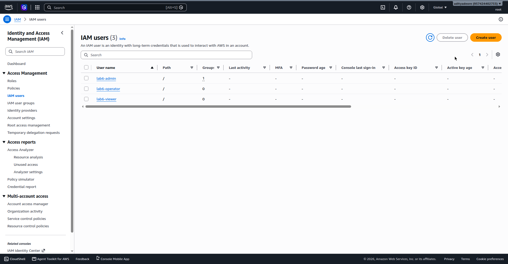
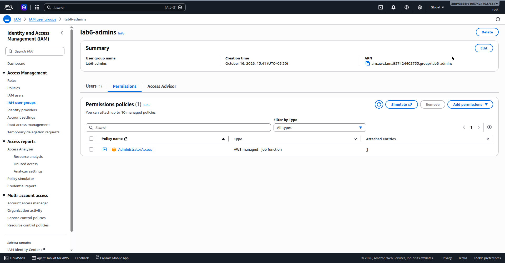
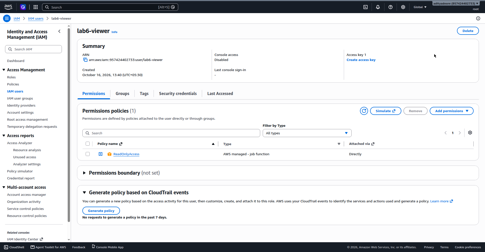
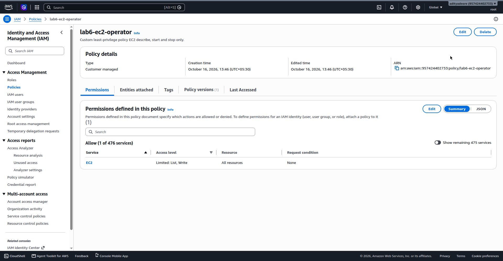
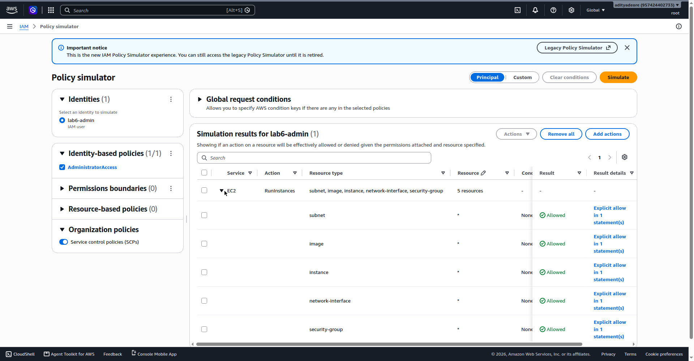
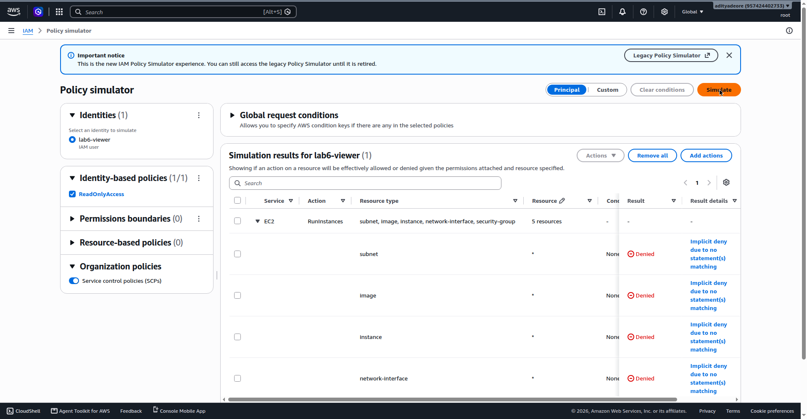
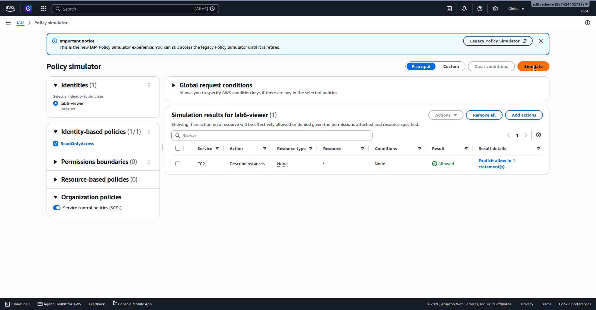

# Pimpri Chinchwad Education Trust's
# Pimpri Chinchwad College of Engineering
## Department of Computer Engineering
### Laboratory Practical / Assignment No. 6

---

**Course:** Cloud Computing (Laboratory)  
**Student Name:** Aditya Chandrajit Deore  
**PRN:** 124B1F116 &nbsp;&nbsp;|&nbsp;&nbsp; **Batch:** B3  
**Title:** Lab 6: Cloud Security Basics (Identity & Access Management - IAM & Permissions)  
**Cloud Platform:** Amazon Web Services (AWS) &nbsp;&bull;&nbsp; **Service:** IAM (Global, 100% Free Service Tier)  
*(Comparative mapping provided for Oracle Cloud Infrastructure - OCI IAM)*

---

## 1. Aim
To understand, configure, and evaluate cloud security governance mechanisms using Identity and Access Management (IAM), including multi-tenant digital identity creation, group-based access administration, granular JSON policy formulation adhering to the Principle of Least Privilege (PoLP), policy simulation verification across Administrator, Read-Only, and Custom roles, and Multi-Factor Authentication (MFA) enforcement.

---

## 2. Objectives
1. To define the architectural role of Identity and Access Management (IAM) as the centralized authentication and authorization control plane in modern cloud computing.
2. To analyze the critical security justifications for IAM, focusing on eliminating shared root credentials, maintaining non-repudiable audit trails, and shrinking attack blast radiuses.
3. To delineate the architectural differences, credential lifecycles, and delegation mechanics between IAM Users, Groups, and Roles.
4. To deconstruct JSON policy grammar (`Effect`, `Action`, `Resource`, `Condition`) and master deterministic policy evaluation rules (Explicit Deny vs. Explicit Allow vs. Default Deny).
5. To implement the Principle of Least Privilege (PoLP) by designing customized, laser-scoped policies restricting cloud actions to strictly required operational subsets.
6. To investigate Multi-Factor Authentication (MFA) paradigms (TOTP, FIDO2/WebAuthn) and evaluate policy-driven conditional access mechanisms.
7. To compare the security posture, operational velocity, and governance overhead of Administrator, Read-Only, and Custom role tiers.
8. To provision IAM users (`lab6-admin`, `lab6-viewer`, `lab6-operator`), assign managed and custom policies, and empirically validate access boundaries using the AWS IAM Policy Simulator.

---

## Part A — Theoretical Foundations

### 1. What is IAM (Identity & Access Management) in Cloud Computing?
**Identity and Access Management (IAM)** is the foundational security framework and centralized management plane in cloud computing that securely controls **WHO** (authenticated entities: human operators, background software daemons, containerized microservices, or external federated systems) can perform **WHAT** actions on **WHICH** specific cloud resources, under **WHICH** operational conditions.

IAM architecture is bifurcated into two indispensable, sequential security checkpoints:
- **Authentication (AuthN) — "Who are you?":** The process of positively verifying the digital identity of a requesting subject before admitting it into the cloud control plane. Mechanisms include console passwords, cryptographic programmatic API access keys (Access Key ID and Secret Access Key), temporary session tokens issued by the AWS Security Token Service (STS), and multi-factor authentication (MFA) tokens.
- **Authorization (AuthZ) — "What are you permitted to do?":** The process of determining the exact API actions the authenticated identity is granted permission to execute against requested cloud resources. Authorization is evaluated dynamically at runtime by policy evaluation engines inspecting attached JSON policy documents.

> **Architectural Note:** In AWS, IAM is a *global service* requiring no regional endpoint selection. Every single incoming API request across all cloud services (EC2, S3, RDS, Lambda, VPC) is intercepted at the edge and evaluated against IAM authorization policies before execution is allowed. IAM carries no operational usage fees.

---

### 2. Why is IAM Important for Securing Cloud Resources?
In cloud computing, traditional physical perimeter defenses (such as firewalls and DMZ boundaries) are insufficient because cloud resources are software-defined and remotely accessible via public RESTful APIs. Consequently, **Identity is the new security perimeter**. IAM is crucial for cloud security due to the following pillars:

1. **Elimination of Shared Root Credentials:** The account root user possesses unrestricted, god-mode administrative power. IAM enables administrators to lock away the root account and provision unique, personal identities for every engineer and workload. Access can be revoked instantly without disrupting others.
2. **Enforcement of Least Privilege (Blast Radius Containment):** By constraining users and microservices to the exact operations needed for their daily workflows, the damage resulting from human error or compromised credentials is tightly bounded.
3. **Comprehensive Non-Repudiable Auditability:** Every API call — whether executed via the AWS Management Console, CLI, SDK, or Terraform — is intercepted and stamped with the caller's unique IAM ARN, timestamp, source IP, and parameters into immutable audit trails (such as AWS CloudTrail), enabling rapid forensic analysis and regulatory compliance (SOC 2, ISO 27001, PCI-DSS).
4. **Dynamic Ephemeral Credentialing via Roles:** Eliminates dangerous hardcoded, long-term API keys in codebases by providing short-lived, auto-rotating STS credentials for compute workloads (EC2 instances, ECS containers, Lambda functions).
5. **Multi-Factor Authentication (MFA) Enforcement:** Adds an essential physical possession barrier, mitigating credential stuffing, password reuse, and phishing compromises.

---

### 3. Difference Between Users, Groups, and Roles in IAM

| Entity Type | Core Definition | Credential Structure | Session Lifespan | Primary Use Case |
| :--- | :--- | :--- | :--- | :--- |
| **IAM User** | A unique digital identity created within an AWS account representing a specific individual person or legacy application needing long-term access. | **Long-term:** Console password (interactive GUI) and/or Access Key ID + Secret Access Key (programmatic CLI/SDK). | Persistent until explicitly rotated, deactivated, or deleted by an administrator. | Individual system administrators, software developers, or on-premises servers syncing data. |
| **IAM Group (User Group)** | A logical collection of IAM users who share common operational functions. Cannot be identified as a principal in policies and cannot log in. | **None:** Groups possess no passwords, access keys, or certificates. Members inherit group permissions. | N/A (Administrative grouping mechanism; no interactive session exists). | Managing permissions at scale (e.g., `Developers`, `DevOps`, `Auditors`, `DBAs`) without editing individual users. |
| **IAM Role** | An identity with defined permissions that is NOT tied to a specific person or long-term credential; assumed temporarily by trusted entities. | **Temporary & Ephemeral:** AWS STS issues short-lived Access Key, Secret Key, and Session Token. | Short-lived (Configurable from 15 minutes up to 12 hours; auto-expires). | Compute workloads (EC2, Lambda), cross-account delegation, and federated SSO (Okta, Azure AD). |

> **Key Architectural Distinction:** An IAM User has long-term static credentials. An IAM Group is merely an administrative container to attach policies to multiple users at once. An IAM Role has no static credentials; it is dynamically assumed by trusted actors who receive short-lived temporary tokens via AWS STS.

---

### 4. What are Permissions and Policies, and How Do They Control Access?
**Permissions** are granular, atomic authorizations that dictate whether a specific action on a specific cloud resource is granted or prohibited (e.g., allowing `ec2:StartInstances` on an EC2 server or `s3:GetObject` on a storage bucket). In cloud architectures, permissions are never assigned arbitrarily; they are formally structured into declarative JSON documents termed **Policies**.

#### Anatomy of an IAM Policy Document:
```json
{
  "Version": "2012-10-17",
  "Statement": [
    {
      "Sid": "AllowEC2StartStopReadOnly",
      "Effect": "Allow",
      "Action": [
        "ec2:Describe*",
        "ec2:StartInstances",
        "ec2:StopInstances"
      ],
      "Resource": "*",
      "Condition": {
        "Bool": { "aws:MultiFactorAuthPresent": "true" }
      }
    }
  ]
}
```

- **Effect:** Must be explicitly set to either `"Allow"` or `"Deny"`.
- **Action:** The specific API method calls governed by the statement (e.g., `s3:ListBucket`, `ec2:RunInstances`). Supports wildcards (`*`).
- **Resource:** The target Amazon Resource Name (ARN) upon which the actions are permitted or denied (e.g., `arn:aws:s3:::my-secure-bucket/*` or `*`).
- **Condition (Optional):** Granular context keys restricting execution (e.g., requiring MFA, limiting client IP CIDR, enforcing TLS versions, or evaluating resource tags).

#### Deterministic Policy Evaluation Logic:
1. **Default Deny:** By default, all requests are implicitly denied.
2. **Explicit Deny Overrides Everything:** If any applicable policy statement evaluates to `Deny`, the request is immediately rejected, regardless of any other allows.
3. **Explicit Allow Required:** In the absence of an explicit Deny, the request must have at least one applicable explicit `Allow` statement to proceed.

---

### 5. What is the Least Privilege Principle? Why is it Important in Cloud Security?
The **Principle of Least Privilege (PoLP)** is a cardinal cybersecurity doctrine dictating that every identity (human user, background process, compute instance, or automation script) must be granted strictly the **bare minimum permissions** necessary to accomplish its intended operational function — and absolutely nothing more.

- **Drastic Blast Radius Mitigation:** In cloud environments, credential exposure is a primary attack vector. If a developer's API key is accidentally committed to a public repository, an identity adhering to least privilege (e.g., read-only access to a specific dev bucket) prevents the adversary from destroying databases, altering route tables, or spinning up expensive cryptocurrency miners.
- **Protection Against Human Error:** Prevents engineers from inadvertently terminating mission-critical production clusters or dropping primary storage volumes during routine maintenance.
- **Regulatory Compliance:** Mandated by leading governance standards including PCI-DSS (Req 7), ISO/IEC 27001 (Control A.9.2), SOC 2 Trust Services, and CIS AWS Foundations Benchmarks.

---

### 6. What is MFA (Multi-Factor Authentication) and How Does it Enhance Account Security?
**Multi-Factor Authentication (MFA)** is a critical identity verification defense requiring a user to furnish two or more distinct, independent categories of authentication factors before access to cloud consoles or APIs is authorized. In computer security, factors are categorized into:
- **Knowledge Factor (Something You Know):** Static passwords, passphrases, or security PINs.
- **Possession Factor (Something You Have):** A physical smartphone generating Time-based One-Time Passwords (TOTP via Google Authenticator, Microsoft Authenticator), a hardware cryptographic token (YubiKey / FIDO2 security key), or an SMS/email verification token.
- **Inherence Factor (Something You Are):** Biometric identifiers (fingerprints, retina patterns, facial geometry).

#### How MFA Enhances Cloud Account Security:
1. **Neutralizes Credential Theft & Phishing:** Over 99% of bulk automated credential stuffing, brute-force dictionary attacks, and phishing compromises are neutralized by MFA. Even if an adversary captures a user's password, authentication fails without the live, rotating TOTP code generated on the victim's physical device.
2. **Protection of Privileged & Root Accounts:** Cloud root accounts and administrative identities hold irrevocable control over business assets. Requiring MFA for all administrative sessions is the single highest-impact security control in cloud governance.
3. **Policy-Enforced Conditional Access:** Administrators can embed MFA checks directly into IAM policies. For instance, a policy can permit developers to read resources with standard login, but mandate an active MFA session (`"aws:MultiFactorAuthPresent": "true"`) before allowing destructive actions like terminating servers or deleting storage volumes.

---

### 7. What are the Differences Between Admin, Read-Only, and Custom Roles in IAM?

| Permission Tier | Scope of Access | Risk & Blast Radius | Maintenance Effort | Typical Use Case |
| :--- | :--- | :--- | :--- | :--- |
| **Administrator Role (`AdministratorAccess`)** | Unrestricted superuser access to all AWS services and API actions (`Action: "*", Resource: "*"`). Can manage billing, users, encryption, and networks. | **Extreme:** Compromise results in complete account takeover, data destruction, or multi-thousand dollar rogue resource bills. | **Zero maintenance:** Pre-built, maintained, and automatically updated by the cloud provider. | Initial cloud account bootstrapping, emergency break-glass procedures, senior infrastructure leads only. |
| **Read-Only Role (`ReadOnlyAccess`)** | Permits viewing, listing, and describing resources across all services (`Get*`, `Describe*`, `List*`). Strictly blocks all write, create, update, and delete actions. | **Low to Moderate:** Zero risk of data loss or service disruption. Data confidentiality risk remains if sensitive resources are visible. | **Zero maintenance:** Pre-built AWS managed policy covering all existing and newly released services automatically. | Security auditors, third-party compliance assessors, junior interns, and external monitoring dashboards. |
| **Custom Role / Policy (e.g., `lab6-ec2-operator`)** | Laser-focused, bespoke JSON policies specifying exact API verbs (e.g., `ec2:StartInstances`) on designated resource ARNs only. | **Minimal:** Strict adherence to Least Privilege. Attack blast radius is confined strictly to the whitelisted actions. | **Moderate to High:** Must be manually authored, tested, documented, and updated as application requirements evolve. | Production workloads, automated CI/CD deployment pipelines, day-to-day engineers performing scoped duties. |

---

## Part B — Practical: IAM Users, Groups, Policies & Simulator Testing

### Step 1 — Create Three IAM Users
Navigated to **AWS IAM Console → Users → Create user**. Provisioned three independent users representing different organizational roles:
1. `lab6-admin`: Designated for full infrastructure management and system administration.
2. `lab6-viewer`: Designated for auditing, resource discovery, and monitoring without modification rights.
3. `lab6-operator`: Designated for targeted compute operations (starting and stopping EC2 instances only).

*Note:* In accordance with laboratory safety standards, no console passwords or long-term access keys were generated for these users, as permission boundaries were evaluated directly via the authoritative AWS IAM Policy Simulator engine.

  
*Figure 1: AWS IAM Users dashboard displaying all three newly provisioned users (`lab6-admin`, `lab6-operator`, and `lab6-viewer`).*

---

### Step 2 — Create the `lab6-admins` User Group with `AdministratorAccess`
To implement access control best practices (never attaching administrative privileges directly to individual users), an IAM User Group was created:
1. Navigated to **IAM → User groups → Create group**.
2. Configured User group name: `lab6-admins`.
3. Attached the AWS-managed policy: `AdministratorAccess` (`arn:aws:iam::aws:policy/AdministratorAccess`).
4. Added user `lab6-admin` as a member of the group.

By leveraging group-based inheritance, `lab6-admin` inherits full administrative privileges without requiring inline or user-level policy clutter, establishing scalable identity governance.

  
*Figure 2: User group `lab6-admins` overview showing attached policy `AdministratorAccess` and assigned member `lab6-admin`.*

---

### Step 3 — Give `lab6-viewer` Read-Only Access
To configure an auditor profile with wide visibility but zero modification permissions:
1. Navigated to **IAM → Users → lab6-viewer → Permissions tab**.
2. Selected **Add permissions → Attach policies directly**.
3. Searched for and selected the AWS-managed policy: `ReadOnlyAccess` (`arn:aws:iam::aws:policy/ReadOnlyAccess`).
4. Reviewed and confirmed attachment.

The `ReadOnlyAccess` policy allows the viewer to query metadata, inspect configurations, and list resources across all AWS services, but strictly denies all mutating API operations (such as `RunInstances`, `DeleteBucket`, or `CreateUser`).

  
*Figure 3: User permissions tab for `lab6-viewer` confirming direct attachment of the AWS-managed `ReadOnlyAccess` policy.*

---

### Step 4 — Create a Custom Least-Privilege Policy for `lab6-operator`
To demonstrate the Principle of Least Privilege (PoLP), a bespoke customer-managed JSON policy was authored to restrict `lab6-operator` to only starting, stopping, and describing EC2 compute instances:
1. Navigated to **IAM → Policies → Create policy**.
2. Switched to the JSON editor and specified the following policy document:
   ```json
   {
     "Version": "2012-10-17",
     "Statement": [
       {
         "Sid": "VisualEditor0",
         "Effect": "Allow",
         "Action": [
           "ec2:Describe*",
           "ec2:StartInstances",
           "ec2:StopInstances"
         ],
         "Resource": "*"
       }
     ]
   }
   ```
3. Named the policy `lab6-ec2-operator` and added description: *Allows EC2 describe, start, and stop only.*
4. Attached this policy directly to user `lab6-operator`.

  
*Figure 4: Creation and summary of custom policy `lab6-ec2-operator` restricting actions strictly to EC2 Describe, Start, and Stop.*

---

### Step 5 — Test: Admin CAN Launch Instances (`ec2:RunInstances`)
To authoritatively verify authorization policies without requiring credential deployment or running live billable workloads, the **AWS IAM Policy Simulator** was utilized:
1. Opened the **AWS IAM Policy Simulator** console.
2. Selected User: `lab6-admin` from the Users pane.
3. Selected Service: **EC2** and checked Action: `RunInstances`.
4. Clicked **Run Simulation**.

**Evaluation Result:** The simulator returned **Allowed** across all five associated resource types (`instance`, `volume`, `network-interface`, `subnet`, `image`) via **Explicit allow** stemming from the inherited `AdministratorAccess` policy. This confirms that administrative identities hold full provisioning authority.

  
*Figure 5: IAM Policy Simulator testing `lab6-admin` executing `ec2:RunInstances` — Result: Allowed on all resources (Explicit allow).*

---

### Step 6 — Test: Read-Only User CANNOT Launch Instances (`ec2:RunInstances`)
Next, verified whether `lab6-viewer`'s `ReadOnlyAccess` successfully prevents modifying or launching compute infrastructure:
1. Selected User: `lab6-viewer` in the IAM Policy Simulator.
2. Selected Service: **EC2** and Action: `RunInstances`.
3. Clicked **Run Simulation**.

**Evaluation Result:** The simulator returned **Denied** with permission state **Implicit deny**. Because `ReadOnlyAccess` only allows reading actions (`Describe*`, `Get*`, `List*`) and contains no `Allow` statement for instance creation, the default deny rule blocked the action completely.

  
*Figure 6: IAM Policy Simulator testing `lab6-viewer` executing `ec2:RunInstances` — Result: Denied (Implicit deny).*

---

### Step 7 — Test: Read-Only User CAN Describe Instances (`ec2:DescribeInstances`)
To verify that `lab6-viewer` is correctly permitted to inspect cloud resources without mutating them:
1. Maintained selection on User: `lab6-viewer` in the IAM Policy Simulator.
2. Selected Service: **EC2** and Action: `DescribeInstances`.
3. Clicked **Run Simulation**.

**Evaluation Result:** The simulator returned **Allowed** under **Explicit allow** through the attached `ReadOnlyAccess` managed policy. This proves that viewing and monitoring operations succeed, providing perfect read-only isolation.

  
*Figure 7: IAM Policy Simulator testing `lab6-viewer` executing `ec2:DescribeInstances` — Result: Allowed (Explicit allow).*

---

### Step 8 — Test: Custom Policy Blocks Actions Outside Its Scope (`s3:CreateBucket`)
To validate that the custom least-privilege policy `lab6-ec2-operator` strictly confines user capabilities and rejects unauthorized actions outside its defined domain:
1. Selected User: `lab6-operator` in the IAM Policy Simulator.
2. Selected Service: **S3** and Action: `CreateBucket`.
3. Clicked **Run Simulation**.

**Evaluation Result:** The simulator returned **Denied** under **Implicit deny**. Because `lab6-ec2-operator` explicitly permits only EC2 Describe, Start, and Stop actions, any attempt to manipulate Amazon S3 buckets is automatically rejected by the IAM Policy Engine.

  
*Figure 8: IAM Policy Simulator testing `lab6-operator` executing `s3:CreateBucket` — Result: Denied (Implicit deny).*

---

### Step 9 — Multi-Factor Authentication (MFA) Setup & Policy Enforcement
To satisfy enterprise hardening standards, MFA is configured for IAM identities to ensure credentials cannot be exploited via single-factor breaches:

1. **MFA Device Enrollment Procedure:**
   - In the IAM Console, navigate to **Users → [Target User] → Security credentials → Assign MFA device**.
   - Specify device name (e.g., `Aditya-Phone-MFA`) and select **Authenticator app** (TOTP).
   - Scan the generated QR code using Google Authenticator or Microsoft Authenticator.
   - Enter two consecutive 6-digit TOTP codes generated 30 seconds apart to synchronize time-based drift, then click **Add MFA**.
2. **Enforcing MFA Programmatically via IAM Policy:**
   Administrators enforce MFA compliance using condition keys. The following policy denies all mutating actions unless an active MFA session is validated:
   ```json
   {
     "Version": "2012-10-17",
     "Statement": [
       {
         "Sid": "BlockEverythingUnlessMFA",
         "Effect": "Deny",
         "NotAction": [
           "iam:CreateVirtualMFADevice",
           "iam:EnableMFADevice",
           "iam:ListMFADevices",
           "iam:ResyncMFADevice",
           "iam:GetUser"
         ],
         "Resource": "*",
         "Condition": {
           "BoolIfExists": { "aws:MultiFactorAuthPresent": "false" }
         }
       }
     ]
   }
   ```

---

## 3. Summary: IAM Policy Simulation Test Matrix

| User Identity | Attached Policy / Role | Tested API Action | Expected Outcome | Simulator Result | Governing Rule |
| :--- | :--- | :--- | :--- | :--- | :--- |
| `lab6-admin` | `AdministratorAccess` (via Group) | `ec2:RunInstances` | Allowed | **Allowed** | Explicit allow in AdministratorAccess policy |
| `lab6-viewer` | `ReadOnlyAccess` (Direct) | `ec2:RunInstances` | Denied | **Denied** | Implicit deny (no mutating allow exists) |
| `lab6-viewer` | `ReadOnlyAccess` (Direct) | `ec2:DescribeInstances` | Allowed | **Allowed** | Explicit allow in ReadOnlyAccess policy |
| `lab6-operator` | `lab6-ec2-operator` (Custom) | `s3:CreateBucket` | Denied | **Denied** | Implicit deny (S3 outside EC2 policy scope) |

---

## 4. Comparative Perspective: Oracle Cloud Infrastructure (OCI) IAM
In **Oracle Cloud Infrastructure (OCI)**, IAM operates on similar security principles with tenancy-level partitioning:
- **Tenancy & Compartments:** OCI organizes all cloud resources into logical administrative containers called *Compartments*.
- **Users & Groups:** Similar to AWS, users are grouped into user groups (e.g., `Administrators`, `SecurityAuditors`, `ComputeOperators`).
- **Policy Syntax:** OCI uses a declarative, human-readable policy grammar rather than JSON:
  $$\text{Allow group } \langle\text{GroupName}\rangle \text{ to } \langle\text{Verb}\rangle \text{ } \langle\text{Resource-Type}\rangle \text{ in compartment } \langle\text{CompartmentName}\rangle$$
- **Verbs Hierarchy:**
  1. `inspect`: Ability to list resources without viewing confidential user metadata.
  2. `read`: Ability to inspect plus get user metadata and resource specifications.
  3. `use`: Ability to work with existing resources (e.g., start/stop compute instances), but not create/delete.
  4. `manage`: Highest privilege level; full control to create, modify, configure, and delete resources.

---

## 5. Conclusion & Key Takeaways
In this laboratory practical, I systematically explored the architectural foundations of Cloud Security through Identity & Access Management (IAM). I investigated the principles of authentication, authorization, and the fundamental differences between Users, Groups, and Roles. By provisioning `lab6-admin`, `lab6-viewer`, and `lab6-operator`, I demonstrated group-based administrative inheritance, managed read-only access, and customer-managed JSON policies enforcing the Principle of Least Privilege (PoLP).

Using the AWS IAM Policy Simulator, I empirically validated that administrative identities possess full provisioning authority, read-only identities can inspect resources without mutation capability, and custom operators are strictly quarantined to assigned EC2 operational verbs while being denied access to other services (such as S3). Finally, I studied Multi-Factor Authentication (MFA) mechanisms and policy enforcement models, solidifying essential best practices for securing enterprise cloud infrastructure.

---

**Student Signature:** Aditya Chandrajit Deore  
**Date:** 17th October 2026  
**PRN:** 124B1F116 &nbsp;&nbsp;|&nbsp;&nbsp; **Batch:** B3  
